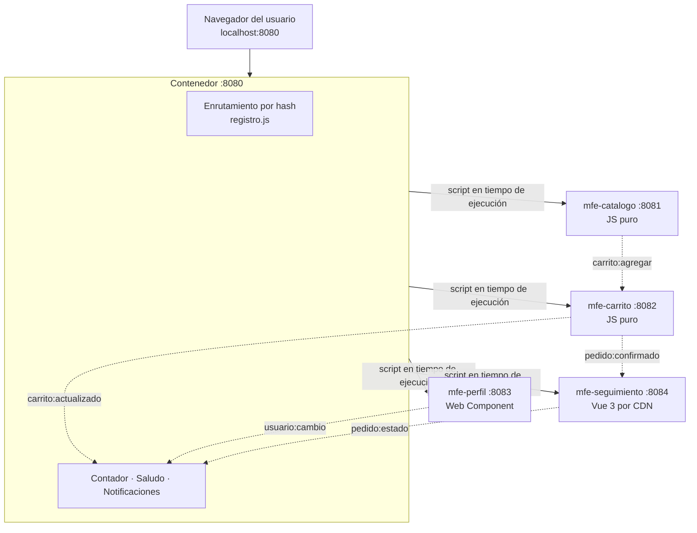

# SaborUPC 2.0

Tienda de comida típica construida con micro frontends para la Actividad 2 de Arquitectura de Aplicaciones Web (Universidad Popular del Cesar, Ingeniería de Sistemas).

Un contenedor carga en tiempo de ejecución cuatro micro frontends, cada uno servido desde su propio puerto y actualizable por separado. Se parte del taller SaborUPC y se agrega un micro frontend nuevo, **Seguimiento de pedidos**, hecho con Vue 3 desde CDN y sin paso de compilación.

**Autor:** Hernán Gutierrez (equipo de 1 integrante, por lo que asume los tres roles: Plataforma, Pedidos y Descubrimiento).

## Arquitectura



Las líneas punteadas son eventos publicados en `window`. Los micro frontends nunca se importan entre sí: quien publica no sabe quién escucha.

## Puertos y URL

| Pieza | Carpeta | Puerto | Tecnología | Ruta | Archivo que carga el contenedor |
|---|---|---|---|---|---|
| Contenedor | `contenedor/` | 8080 | HTML + JS | `/` | n/a |
| Catálogo | `mfe-catalogo/` | 8081 | JS puro | `#/catalogo` | `catalogo.js` |
| Carrito | `mfe-carrito/` | 8082 | JS puro | `#/carrito` | `carrito.js` |
| Perfil | `mfe-perfil/` | 8083 | Web Component | `#/perfil` | `perfil.js` |
| Seguimiento | `mfe-seguimiento/` | 8084 | Vue 3 (CDN) | `#/pedidos` | `seguimiento.js` |

Cada micro frontend también se puede abrir solo (modo independiente) en `http://localhost:PUERTO`.

## Cómo ejecutar

Requisitos: Node.js y un navegador moderno. Vue se descarga de `unpkg.com`, así que hace falta conexión a internet.

Abrir cinco terminales, una por carpeta, desde la raíz del proyecto:

```powershell
cd contenedor;        npx http-server -p 8080 -c-1
cd mfe-catalogo;      npx http-server -p 8081 -c-1
cd mfe-carrito;       npx http-server -p 8082 -c-1
cd mfe-perfil;        npx http-server -p 8083 -c-1
cd mfe-seguimiento;   npx http-server -p 8084 -c-1
```

Después abrir `http://localhost:8080`.

La bandera `-c-1` desactiva la caché del servidor, para ver cada cambio al recargar.

## Qué incluye cada requisito

| # | Requisito | Dónde está |
|---|---|---|
| 1 | Organización en carpetas con historial propio | Una carpeta por micro frontend, con commits separados por pieza |
| 2 | MFE Seguimiento | `mfe-seguimiento/`: escucha `pedido:confirmado`, avanza estados con `setInterval` y publica `pedido:estado`; el contenedor muestra la notificación |
| 3 | Tecnología distinta | Seguimiento usa Vue 3 (`vue@3.4.38`) por CDN, con el mismo contrato `renderSeguimiento` / `unmountSeguimiento` |
| 4 | Contratos documentados | `contenedor/CONTRATOS.md` |
| 5 | Prueba de contrato | `mfe-seguimiento/contrato.html`, en `http://localhost:8084/contrato.html` |
| 7 | Resiliencia | Mensaje de error con botón **Reintentar** en el contenedor |
| 8 | Despliegue independiente | Demostrado en local en el video |

## Contratos

Los eventos y las reglas de compatibilidad están en [`contenedor/CONTRATOS.md`](contenedor/CONTRATOS.md). Resumen:

| Evento | Publica | Escucha | `detail` |
|---|---|---|---|
| `carrito:agregar` | catálogo | carrito | `{ id, nombre, precio }` |
| `carrito:actualizado` | carrito | contenedor | `{ cantidad, total }` |
| `usuario:cambio` | perfil | contenedor | `{ nombre }` |
| `pedido:confirmado` | carrito | seguimiento | `{ version, id, items[], total }` |
| `pedido:estado` | seguimiento | contenedor | `{ version, id, estado }` |

## Decisiones de diseño

- **Eventos en `window` y no llamadas directas.** Ningún micro frontend importa código de otro, así que el único acoplamiento es el nombre y la forma del evento.
- **Precarga del carrito y del seguimiento** (`precargar: true` en `registro.js`). Ambos registran su listener al cargar el script, no al montarse. Si se descargaran solo al entrar a su ruta, perderían los eventos publicados antes.
- **Seguimiento en dos capas.** Los datos (lista de pedidos, listener y `setInterval`) viven en JS puro mientras el script esté cargado; la vista Vue se crea en `render` y se destruye en `unmount`. Así los pedidos siguen avanzando, y las notificaciones siguen llegando, aunque el usuario esté en otra ruta.
- **Vue cargado bajo demanda y con versión fija.** Se descarga la primera vez que se monta la vista, con una versión exacta para que un cambio del CDN no rompa la aplicación.
- **Campo `version` en los eventos de pedidos.** Permite evolucionar el contrato sin romper consumidores; las reglas están en `CONTRATOS.md`.
- **`textContent` en las notificaciones.** El texto viene de un evento de otro equipo, así que no se inserta como HTML.
- **Estado en memoria.** Los pedidos se pierden al recargar la página. Es una simulación; en producción vendrían de un servidor.
- **Una carpeta por micro frontend dentro de un mismo repositorio.** Es el alcance permitido para un equipo de una persona; cada carpeta se puede separar en su propio repositorio sin cambios de código.

## Alcance y límites

Por ser un equipo de un integrante se dejaron fuera, según la tabla de alcance de la actividad, `tokens.css` (opcional) y las pruebas de contrato de Catálogo, Carrito y Perfil. Tampoco se miden tiempos de carga con `performance.now()`.

## Estructura

```
taller-microfrontends/
├── contenedor/          # :8080  index.html, contenedor.css, registro.js, contenedor.js, CONTRATOS.md
├── mfe-catalogo/        # :8081  catalogo.js, index.html
├── mfe-carrito/         # :8082  carrito.js, index.html
├── mfe-perfil/          # :8083  perfil.js, index.html
└── mfe-seguimiento/     # :8084  seguimiento.js, index.html, contrato.html
```

## Video

https://drive.google.com/file/d/1JdwbZj66a9SRR9YBkI-GTEzMo9hij8wc/view?usp=sharing